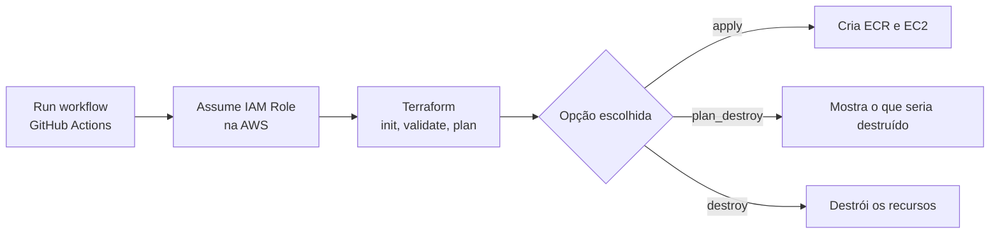

# Infra-as-code

Infraestrutura na AWS criada com Terraform e executada por um workflow no GitHub Actions, com acionamento manual por botões.

Este repositório faz parte do meu laboratório de DevOps. Comecei com a landing page de um restaurante da família, que containerizei com Docker e publiquei manualmente na AWS. Aqui está a segunda etapa: automatizar a criação e a destruição dessa infraestrutura.

## O que este projeto faz

- Cria um repositório no **Amazon ECR** e uma instância **Amazon EC2** com Terraform.
- Executa o fluxo `init → validate → plan → apply` no **GitHub Actions**.
- Permite escolher, na hora de rodar o workflow, se quer aplicar, planejar a destruição ou destruir os recursos.
- Autentica na AWS assumindo uma **IAM Role** (OIDC), sem chaves de acesso salvas no repositório.
- Guarda o state do Terraform em um bucket **S3**, com criptografia e lock.

## Arquitetura



## Estrutura do repositório

```
.
├── .github/
│   └── workflows/
│       └── terraform.yaml        # Workflow "Terraform CI/CD"
├── backend.tf                    # Backend S3 do state (o bucket é informado no init)
├── ec2.tf                        # Instância EC2 e security group
├── ecr.tf                        # Repositório ECR
├── provider.tf                   # Provider AWS
├── variables.tf                  # Variáveis (IP e VPC)
├── terraform.tfvars.example      # Exemplo de valores para uso local
└── backend.hcl.example           # Exemplo de configuração do bucket para uso local
```

## Configuração

Os valores específicos da conta AWS não ficam no código. No GitHub, eles são configurados em **Settings → Secrets and variables → Actions → Secrets**:

| Secret | Para que serve |
|---|---|
| `AWS_ROLE_ARN` | ARN da IAM Role que o workflow assume |
| `TF_STATE_BUCKET` | Nome do bucket S3 do state |
| `VPC_ID` | ID da VPC onde o security group é criado |
| `MY_IP` | IP público com acesso à EC2, em formato CIDR (ex: `203.0.113.10/32`) |

A IAM Role precisa de uma trust policy que aceite apenas este repositório e a branch `main`, com permissões limitadas ao que o Terraform precisa (ECR, EC2 e o bucket do state).

### Uso local

```bash
cp terraform.tfvars.example terraform.tfvars   # preencha com seus valores
cp backend.hcl.example backend.hcl             # preencha com o seu bucket

terraform init -backend-config=backend.hcl
terraform plan
```

Os arquivos `terraform.tfvars` e `backend.hcl` estão no `.gitignore` e não são versionados.

## Como usar o workflow

1. Abra a aba **Actions** do repositório.
2. Selecione o workflow **Terraform CI/CD**.
3. Clique em **Run workflow** e escolha as opções:

| Opção | Nome do input | O que faz |
|---|---|---|
| Executar o terraform apply? | `apply` | Se `true`, cria ou atualiza a infraestrutura |
| Planejar destruição de recursos? | `plan_destroy` | Se `true`, gera o plano de destruição sem destruir nada |
| Destruir recursos? | `destroy` | Se `true`, destrói os recursos criados (use junto com `plan_destroy`) |

4. Clique em **Run workflow** novamente para iniciar.

Todas as opções começam em `false`. Com tudo em `false`, o workflow roda apenas `init`, `validate` e `plan`, sem alterar nada na AWS.

## Etapas do pipeline

1. **Checkout** do código.
2. **Configure AWS credentials**: assume a IAM Role na região `us-east-2`.
3. **Setup Terraform** (HashiCorp).
4. **Terraform Init**.
5. **Terraform Validate**.
6. **Terraform Plan**.
7. **Terraform Apply**, somente se `apply = true`.
8. **Plan Destroy**, somente se `plan_destroy = true`.
9. **Terraform Destroy**, somente se `destroy = true`.

## Segurança

- O acesso do GitHub à AWS é feito por IAM Role (OIDC), sem chaves de acesso fixas no repositório.
- IP, ID da VPC, ARN da role e nome do bucket ficam em secrets do GitHub, e não no código.
- O state do Terraform fica em um bucket S3 com criptografia e lock, e não é versionado.
- O acesso à instância é liberado apenas para o meu IP.
- O workflow só roda por acionamento manual (`workflow_dispatch`).
- O destroy automatizado ajuda a não deixar recursos ligados e gerar custo sem necessidade.

## Próximos passos

- [ ] Automatizar o deploy da aplicação
- [ ] HTTPS
- [ ] Domínio próprio
- [ ] Monitoramento

## O que aprendi

- Infraestrutura em código é versionada e fácil de recriar.
- Rodar o `plan` antes do `apply` evita erros antes de alterar a infraestrutura.
- Valores sensíveis não devem ficar no repositório: ficam em secrets e variáveis.
- Foram 16 execuções até o fluxo ficar estável.

## Autor

Edilson Junior
